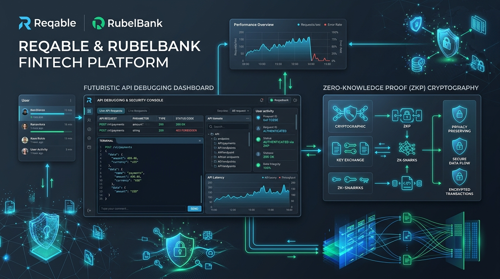
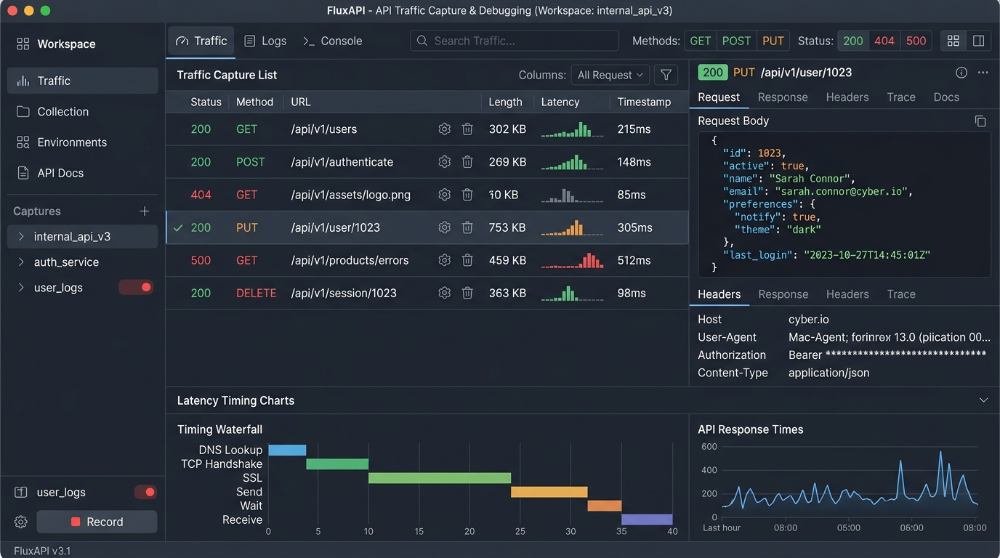
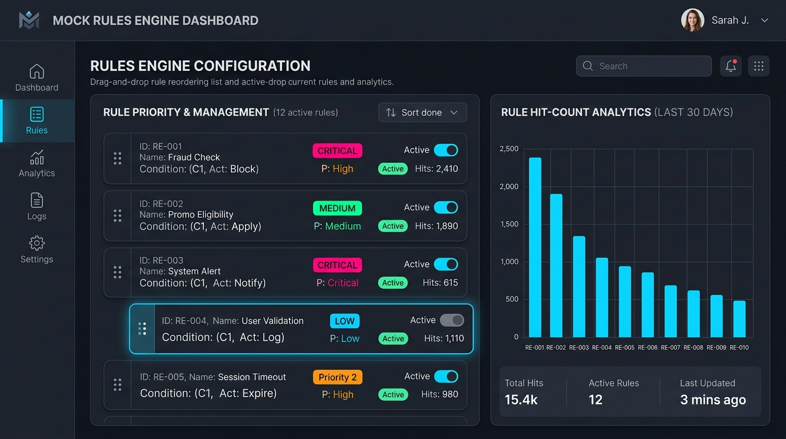
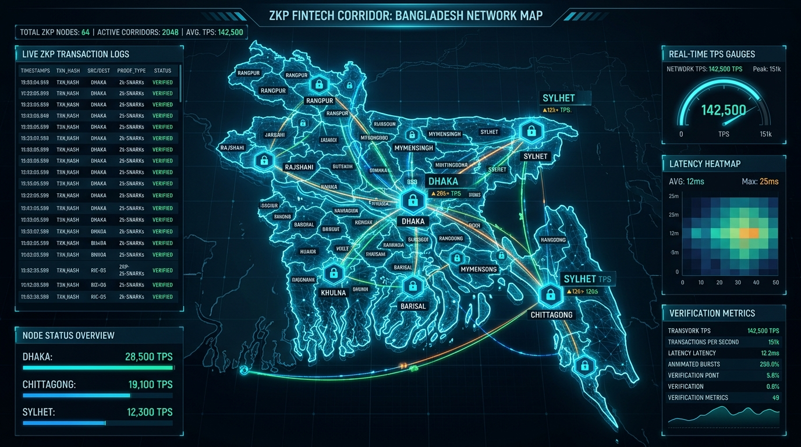

# 🚀 Reqable & RubelBank FinTech Platform

> **All-in-One API Debugging, Testing, Mocking Platform & 64-District ZKP FinTech Corridor**

<p align="center">
  <a href="#"></a>
  <a href="#"></a>
  <a href="#"></a>
  <a href="#"></a>
  <a href="#"></a>
  <a href="#"></a>
  <a href="#"></a>
  <a href="#"></a>
  <a href="#"></a>
</p>

[English Overview](#-english-overview) | [বাংলা বিবরণ](#-বাংলা-সংক্ষিপ্ত-পরিচিতি) | [ছবিসমূহ / Screenshots](#-গ্যালারি-ও-স্ক্রিনশট-gallery) | [ZKP Vault Architecture](#-zkp-vault-architecture--বাংলাদেশের-৬৪-জেলা-করিডোর)

---

## 🌟 Hero Platform Banner



---

## 🇧🇩 বাংলা সংক্ষিপ্ত পরিচিতি

**Reqable & RubelBank** হলো একটি অত্যাধুনিক, ফুল-স্ট্যাক এপিআই ডিবাগিং, টেস্ট অটোমেশন এবং জিরো-নলেজ প্রুফ (ZKP) ফিনটেক নেটওয়ার্ক প্ল্যাটফর্ম। এটি ডেভলপারদের জন্য রিয়েল-টাইম ট্রাফিক ক্যাপচার, কাস্টম মক রুলস ইঞ্জিন, ড্র্যাগ-অ্যান্ড-ড্রপ অগ্রাধিকার সেটআপ, ৬৪-জেলা নোড মনিটরিং, ফায়ারবেস ফায়ারস্টোর ক্লাউড সিঙ্ক এবং জেমিনি এআই কোপাইলট (Gemini AI Copilot) সুবিধা প্রদান করে।

---

## 🖼️ গ্যালারি ও স্ক্রিনশট (Gallery)

### 📊 ১. রিয়েল-টাইম ট্রাফিক ক্যাপচার ও ডিবাগার (Traffic Debugger Dashboard)

*চিত্র ১: রিয়েল-টাইম HTTP/HTTPS রিকোয়েস্ট ও রেসপন্স ফিল্টারিং, টাইমিং ভিজ্যুয়ালাইজেশন এবং হেডার পরিদর্শন।*

---

### 🛡️ ২. মক রুলস ইঞ্জিন ও ড্র্যাগ-অ্যান্ড-ড্রপ অগ্রাধিকার (Mock Rules Engine)

*চিত্র ২: ড্র্যাগ-অ্যান্ড-ড্রপ করে মক রুলস ইন্টারসেপ্ট রিয়েল-টাইম প্রাইওরিটি সেটআপ, ফোল্ডার গ্রুপিং এবং হিট-কাউন্ট ড্যাশবোর্ড।*

---

### 🗺️ ৩. ৬৪-জেলা ZKP ফিনটেক নোড করিডোর (ZKP District Nodes Map)

*চিত্র ৩: সমগ্র বাংলাদেশের ৬৪টি জেলা নোডের মধ্যে জিরো-নলেজ প্রুফ সিকিউরিটি ও রিয়েল-টাইম টিপিএস মনিটরিং ক্যানভাস।*

---

## 🔐 ZKP Vault Architecture & বাংলাদেশের ৬৪ জেলা করিডোর

Reqable & RubelBank প্ল্যাটফর্মটি জিরো-নলেজ প্রুফ (Zero-Knowledge Proof) ক্রিপ্টোগ্রাফি প্রযুক্তি ব্যবহার করে বাংলাদেশের ৬৪টি জেলায় আন্তঃব্যাংকিং লেনদেন এবং ডাটা ভেরিফিকেশন সম্পাদন করে:

```
+-----------------------------------------------------------------------------------+
|                            Reqable MITM Engine & ZKP Proxy                         |
+-----------------------------------------------------------------------------------+
                                          |
         +--------------------------------+--------------------------------+
         |                                |                                |
         v                                v                                v
+------------------+             +------------------+             +------------------+
|   Dhaka Node     |<===========>| Chittagong Node  |<===========>|  Sylhet Node     |
| (ZKP Proof Gen)  |  Inter-Node | (ZKP Proof Gen)  |  Inter-Node | (ZKP Proof Gen)  |
+------------------+   Latency   +------------------+   Latency   +------------------+
         ^                                ^                                ^
         |                                |                                |
         +--------------------------------+--------------------------------+
                                          |
                                          v
                         +---------------------------------+
                         |  64-District ZKP Ledger Vault   |
                         | (Firestore Sync & Audit Hashes) |
                         +---------------------------------+
```

---

## 🌟 প্রধান বৈশিষ্ট্যসমূহ (Key Features)

### 📡 ১. রিয়েল-টাইম এপিআই ট্রাফিক ক্যাপচার ও ডিবাগার (API Debugging)
- **লাইভ ট্রাফিক মনিটর**: সেন্ড এবং রিসিভ করা প্রতিটি HTTP/HTTPS রিকোয়েস্ট ও রেসপন্স পর্যবেক্ষণ।
- **প্যারামিটার ও হেডার এডিটর**: কাস্টম হেডার, কোয়েরি পারামস, এবং JSON পেলোড ফিল্টারিং ও অটো-ফরম্যাটিং।
- **রেসপন্স টাইমিং ও স্ট্যাটাস ফিল্টার**: লেটেন্সি, স্ট্যাটাস কোড (2xx, 4xx, 5xx) এবং সময়কাল অনুযায়ী ফিল্টারিং।

### 🛡️ ২. মক রুলস ইঞ্জিন ও ড্র্যাগ-অ্যান্ড-ড্রপ অগ্রাধিকার (Mock Rules Engine)
- **ইন্টারসেপ্ট ও ড্র্যাগ-অ্যান্ড-ড্রপ রিঅর্ডার**: ড্র্যাগ-অ্যান্ড-ড্রপ করে মক রুলসমূহের প্রয়োগের ক্রম (Priority) পরিবর্তন করার সুবিধা।
- **মক ড্যাশবোর্ড (Mini Bar Chart)**: প্রতিটি মক রুলের ইন্টারসেপশন ফ্রিকোয়েন্সি (Frequency) এবং হিট-কাউন্ট (Hit Count) গ্রাফিকাল ভিজ্যুয়ালাইজেশন।
- **ব্যাচ ইমপোর্ট ও এক্সপোর্ট**: JSON ফাইলের মাধ্যমে এক সাথে একাধিক রুলস ফাইল এক্সপোর্ট ও ইমপোর্ট করার সুবিধা।
- **ফোল্ডার গ্রুপিং ও ট্যাগিং**: ফোল্ডারে মক রুলস সাজানো ও কলাপ্স করার ব্যবস্থা।

### 🗺️ ৩. ৬৪-জেলা নোড করিডোর ও ZKP সিকিউরিটি (64-District ZKP Corridor)
- **বাংলাদেশের ৬৪ জেলা নোড ক্যানভাস ম্যাপ**: সমগ্র বাংলাদেশের ৬৪টি জেলা নোডের মধ্যে রিয়েল-টাইম ইন্টার-নোড লেটেন্সি এবং টিপিএস (Transactions Per Second) মনিটরিং।
- **জিরো-নলেজ প্রুফ (ZKP Vault)**: ব্যালেন্স ও ট্রানজেকশন তথ্য গোপন রেখে ক্রিপ্টোগ্রাফিক প্রুফ জেনারেশন।
- **এনক্রিপ্টেড সিকিউরিটি অডিট লগ**: এনক্রিপ্টেড অডিট লগ এবং ট্যাম্পার-প্রুফ হ্যাশ হিস্ট্রি।

### 🤖 ৪. এআই কোপাইলট (AI Assistant Powered by Gemini)
- **অটোমেটেড পেলোড ও কোড জেনারেটর**: কাস্টম API টেস্ট স্ক্রিপ্ট, cURL কমান্ড এবং কাস্টম মক পেলোড তৈরি।
- **স্মার্ট ডিবাগিং ও এরর ফিক্সিং**: রেসপন্স এরর কোড বিশ্লেষণ করে সম্ভাব্য সমাধান প্রস্তাব।

### ☁️ ৫. ক্লাউড সিঙ্ক ও ফায়ারবেস ইন্টিগ্রেশন (Firebase Cloud Sync)
- **ফায়ারবেস অথেন্টিকেশন ও ফায়ারস্টোর (Firestore DB)**: সুরক্ষিত ক্লাউড স্টোরেজ ও গুগল সাইন-ইন সমর্থন।
- **গুগল ড্রাইভ সিঙ্ক**: API কলেকশন ও এনভায়রনমেন্ট কনফিগারেশন ব্যাকআপ ও রিস্টোর করার সুবিধা।

---

## 🛠️ ব্যবহৃত টেকনোলজি স্ট্যাক (Tech Stack)

| ক্যাটাগরি | টেকনোলজি |
| :--- | :--- |
| **Frontend Framework** | React 19, TypeScript, Vite |
| **Styling & UI Components** | Tailwind CSS v4, Lucide Icons, Motion (Framer) |
| **Drag & Drop Reordering** | `@dnd-kit/core`, `@dnd-kit/sortable` |
| **Data Visualization** | Recharts (Bar Charts, Latency Graphs) |
| **Backend & API Proxy** | Express.js, Node.js (Full-stack Server) |
| **Database & Auth** | Firebase Firestore, Firebase Authentication |
| **AI Integration** | Google Gemini API (`@google/genai`) |
| **Build & Tooling** | esbuild, tsx, TypeScript Compiler |

---

## 🚀 ইনস্টলেশন ও রান করার নিয়ম (Installation Guide)

### পূর্বশর্ত (Prerequisites)
- **Node.js**: v18.0.0 বা তার পরবর্তী সংস্করণ
- **npm** বা **bun** প্যাকেজ ম্যানেজার

### ধাপসমূহ (Steps)

1. **প্রজেক্ট ক্লোন বা ডাউনলোড করুন**:
   ```bash
   git clone <repository-url>
   cd reqable-app
   ```

2. **ডিপেন্ডেন্সি ইনস্টল করুন**:
   ```bash
   npm install
   ```

3. **এনভায়রনমেন্ট ভেরিয়েবল সেটআপ করুন**:
   `.env.example` ফাইল অনুকরণ করে একটি `.env` ফাইল তৈরি করুন এবং প্রয়োজনীয় API Key যুক্ত করুন:
   ```env
   GEMINI_API_KEY=your_gemini_api_key_here
   ```

4. **ডেভেলপমেন্ট সার্ভার শুরু করুন**:
   ```bash
   npm run dev
   ```
   অ্যাপ্লিকেশনটি ব্রাউজারে `http://localhost:3000` এ রান হবে।

5. **বিল্ড প্রসেস (Production Build)**:
   ```bash
   npm run build
   npm start
   ```

---

## 📁 প্রজেক্ট আর্কিটেকচার (Project Structure)

```
├── README.md                   # প্রজেক্ট গাইডলাইন ও ডকুমেন্টস (ছবিসহ)
├── firebase-applet-config.json # ফায়ারবেস ক্লাউড কনফিগারেশন
├── firebase-blueprint.json     # ফায়ারস্টোর ডাটাবেজ স্কিমা
├── firestore.rules             # ফায়ারস্টোর সিকিউরিটি রুলস
├── metadata.json               # অ্যাপ মেটাডেটা ও ক্যাপাবিলিটি
├── package.json                # ডিপেন্ডেন্সি ও বিল্ড স্ক্রিপ্ট
├── server.ts                   # ফুল-স্ট্যাক এক্সপ্রেস ব্যাকএন্ড সার্ভার
└── src/
    ├── assets/images/          # স্ক্রিনশট ও ডেমো ইমেজেস
    │   ├── reqable_platform_banner_1786291996003.jpg
    │   ├── traffic_debugger_preview_1786292019481.jpg
    │   ├── mock_rules_engine_preview_1786292041296.jpg
    │   └── zkp_district_nodes_preview_1786292063708.jpg
    ├── components/             # রিয়্যাক্ট কম্পোনেন্টসমূহ
    │   ├── ApiDebuggingTab.tsx # ট্রাফিক ডিবাগার
    │   ├── ApiTestingTab.tsx   # টেস্ট অটোমেশন
    │   ├── RulesEngineTab.tsx  # মক রুলস ড্যাশবোর্ড ও ড্র্যাগ-অ্যান্ড-ড্রপ
    │   ├── WebHubTab.tsx       # ৬৪-জেলা নোড মনিটর
    │   ├── McpServerTab.tsx    # মডেল কন্টেক্সট প্রোটোকল
    │   ├── ReadmeModal.tsx     # রিডমি গ্যালারি ও ডায়ালগ
    │   └── AiCopilotDrawer.tsx # জেমিনি এআই অ্যাসিস্ট্যান্ট
    ├── context/                # গ্লোবাল স্টেট ও কন্টেক্সট
    ├── lib/                    # ফায়ারবেস ও ইউটিলিটি মডিউল
    └── types/                  # টাইপস্ক্রিপ্ট ইন্টারফেস
```

---

## 🇬🇧 English Overview

### About Reqable & RubelBank Ecosystem
**Reqable** is a modern, developer-centric API debugging, testing, mocking, and ZKP FinTech operations dashboard. It allows software engineers and network analysts to intercept live HTTP requests, reorder mock interception rules using intuitive drag-and-drop interface, track rule hit-counts via visual mini-bar charts, monitor district node networks, and sync environments effortlessly using Firebase Cloud Storage.

### Visual Architecture & Previews
- **Platform Banner**: `./src/assets/images/reqable_platform_banner_1786291996003.jpg`
- **Traffic Debugger Dashboard**: `./src/assets/images/traffic_debugger_preview_1786292019481.jpg`
- **Mock Rules Engine**: `./src/assets/images/mock_rules_engine_preview_1786292041296.jpg`
- **64-District ZKP Vault Map**: `./src/assets/images/zkp_district_nodes_preview_1786292063708.jpg`

### Key Capabilities
- **Live Traffic Inspection**: Full request/response inspection with headers, payload formatting, and timing analysis.
- **Interactive Mock Dashboard**: Priority-based mock rule execution with drag-and-drop reordering, folder grouping, batch JSON import/export, and real-time hit frequency charts.
- **Gemini AI Copilot**: Generate payloads, test scripts, and mock schemas automatically using Google's Gemini models.
- **64-District Node Map**: Real-time visualization of latency and TPS across all 64 districts in Bangladesh.
- **Cloud Persistence**: Firebase Firestore integration for synchronized API collections and multi-device support.

---

## 🔒 সিকিউরিটি ও প্রাইভেসি (Security)

- কোনো সিক্রেট API Key বা সংবেদনশীল ক্রেডেনশিয়াল ক্লায়েন্ট সাইডে উন্মুক্ত করা হয় না।
- ফায়ারস্টোর সিকিউরিটি রুলস অনুচ্ছেদ অনুযায়ী সুরক্ষিত অথেনটিকেটেড ইউজার এক্সেস নিশ্চিত করা হয়েছে।

---

© 2026 **Reqable & RubelBank Ecosystem**. All rights reserved.
